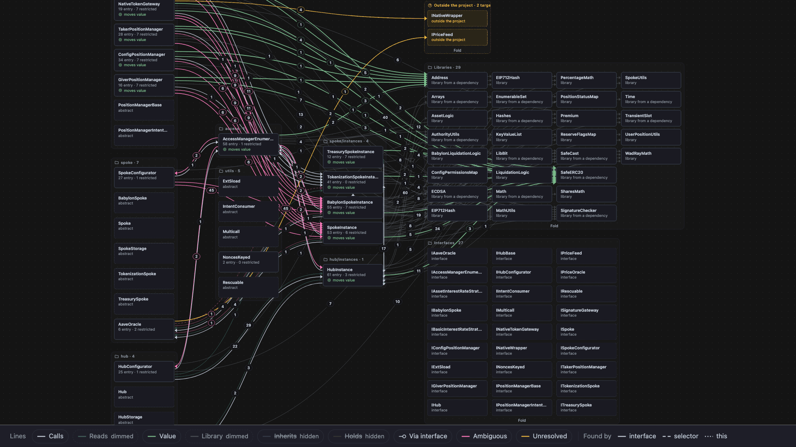
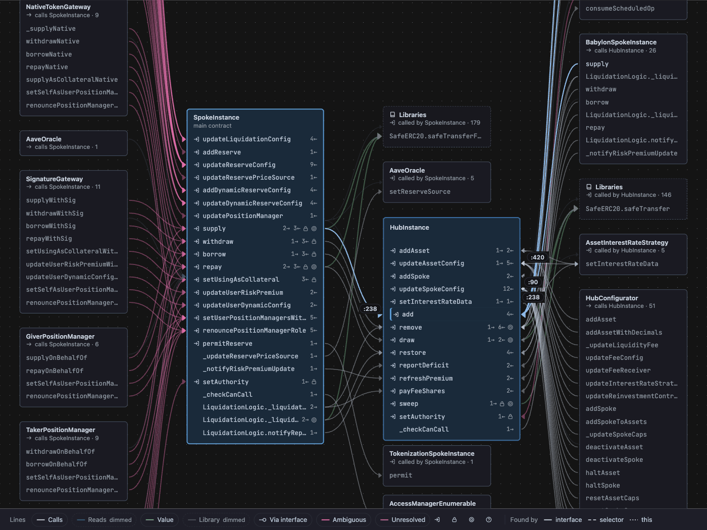
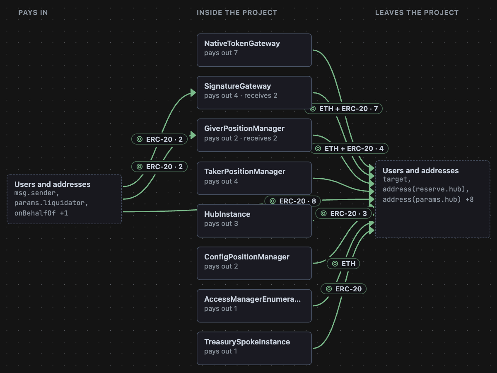
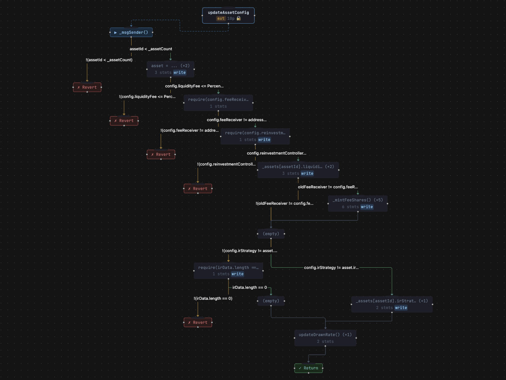
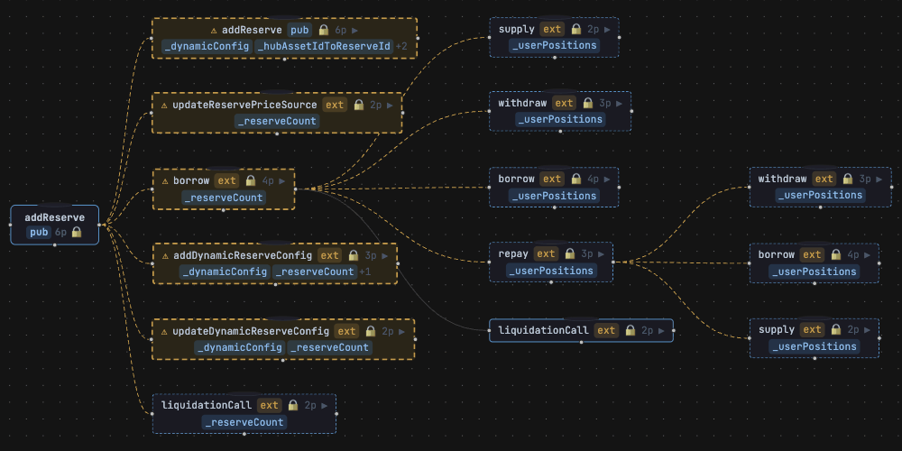
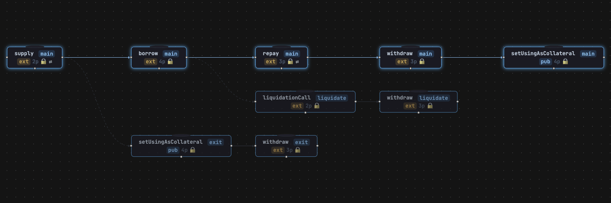
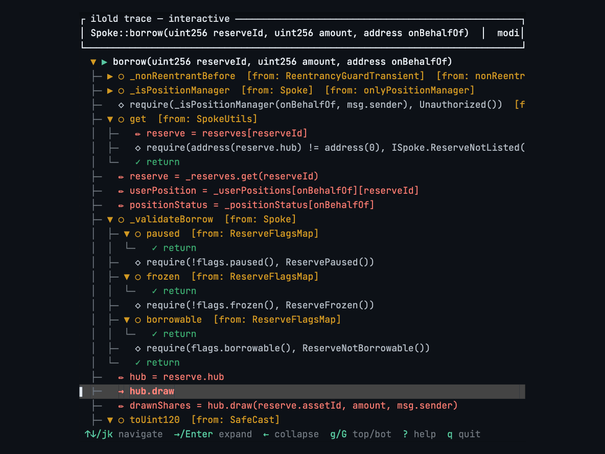

<p align="center">
  
</p>

<p align="center">
  <b>Interactive auditing for Solidity.</b><br>
  See who calls what, who can run it, where value moves and how state changes.<br>
  Use it from a web app, a REPL or an AI agent.
</p>

<p align="center">
  <a href="#install">Install</a> ·
  <a href="#what-you-can-do-with-ilold">What you can do</a> ·
  <a href="#a-tour">Tour</a> ·
  <a href="#ai-agents-mcp">MCP</a> ·
  <a href="#graph-export">Graph export</a> ·
  <a href="docs/guide/src/SUMMARY.md">Docs</a>
</p>

<p align="center">
  
  
  
</p>

<p align="center">
  <a href="images/project-map.png"></a><br>
  <sub>Project map of Aave v4, contracts grouped by folder.</sub>
</p>

## What you can do with ilold

| Task | Web | REPL | MCP |
|---|---|---|---|
| Map a protocol and what its contracts depend on | Project › Map | `contracts all`, `deps Vault`, `usedby Vault` | `ilold_project_map`, `ilold_contract_dependencies` |
| Follow the calls between contracts | Connections, Project › Route | `links Vault`, `route Vault LendingPool` | `ilold_connections`, `ilold_route` |
| Find who can call a function and which guards protect it | Sidebar, Inspector | `functions`, `info deposit` | `ilold_entry_points`, `ilold_function_analysis` |
| See who pays whom, and in which asset | Project › Value flow | `value` | `ilold_value_flow` |
| Walk the paths of a function and see which ones revert | CFG | `trace deposit`, `info deposit` | `ilold_cfg`, `ilold_function_paths` |
| Find the functions that read or write a variable, by mapping key | Inspector | `who balances` | `ilold_who_touches` |
| Build call sequences and fork them into scenarios | Seq, Session | `call deposit`, `scenario fork attack` | `ilold_sequences`, `ilold_session_call` |
| Follow a variable across the steps of a sequence | Session › Timeline | `timeline totalStaked` | `ilold_timeline` |
| Slice where a value comes from and where it goes | | `slice deposit totalStaked` | `ilold_slice` |
| Record findings and notes, then export a report | | `finding`, `note`, `export` | `ilold_record_finding`, `ilold_note`, `ilold_export` |

The web app, the REPL and the MCP tools read the same model.

Calls are resolved from the solc AST. In `IPool pool; pool.supply()`, the call goes to `IPool.supply` and to the contracts that implement it.

## Install

```bash
git clone https://github.com/scab24/ilold-evm.git && cd ilold-evm && ./install.sh
```

`install.sh` checks for Rust and Node.js, builds the web app and installs `ilold` into `~/.cargo/bin`. To update, run `git pull && ./install.sh`.

```bash
ilold explore path/to/foundry-project
```

Enter `browser` to open the web app. [Getting Started](docs/guide/src/getting-started.md) covers building by hand, ports, network access, `--attach` and exit codes.

## A tour

### 1. The protocol

<table>
<tr>
<td width="50%"><a href="images/connections-board.png"></a><br><b>Connections</b><br><sub>Who a contract calls and who calls it, function by function. Open a neighbour in place to follow a call across contracts.</sub></td>
<td width="50%"><a href="images/value-flow.png"></a><br><b>Value flow</b><br><sub>Where ETH and tokens enter the project, move between its contracts and leave it, by asset.</sub></td>
</tr>
</table>

### 2. Inside a function

<table>
<tr>
<td width="60%"><a href="images/cfg.png"></a></td>
<td width="40%">
<b>CFG</b><br>
The paths a function can take, the conditions each one needs and where it reverts. Modifiers are inlined. Selecting a path lists its conditions and what it runs.
<br><br>
<b>Inspector</b><br>
Guards, storage reads and writes with their mapping keys, value transfers and try/catch clauses.
</td>
</tr>
</table>

### 3. Call sequences

Two modes for calls that follow each other.

<table>
<tr>
<td width="40%"><a href="images/sequences.png"></a><br><b>Seq mode</b><br><sub>What can run next. Expand a function into the calls that can follow it. A dashed line marks a next call that uses state the previous one writes.</sub></td>
<td width="60%"><a href="images/session.png"></a><br><b>Session mode</b><br><sub>A sequence you build. Add calls one by one, fork it into scenarios at any step and see what each step changes.</sub></td>
</tr>
</table>

### 4. Terminal

The REPL reads the same model and runs inside the web app.

<table>
<tr>
<td width="55%"><a href="images/repl-trace-interactive.png"></a><br><sub><code>trace borrow -i</code> opens the execution tree full screen.</sub></td>
<td width="45%">
<b>Trace viewer keys</b>
<ul>
<li>Arrows or <code>h</code> <code>j</code> <code>k</code> <code>l</code> move and expand</li>
<li><code>g</code> and <code>G</code> jump to the start or end</li>
<li><code>?</code> shows the keys</li>
<li><code>q</code> quits</li>
</ul>
<b>REPL help</b>
<ul>
<li><code>?</code> lists the commands in the groups Session, Analysis, Contract, Findings and Workspace</li>
<li>A command followed by <code>?</code> shows its help</li>
<li>Tab completes commands and names</li>
</ul>
</td>
</tr>
</table>

## AI agents (MCP)

`ilold evm-mcp` gives an AI agent 30 tools over a running `ilold serve`. The tools cover orientation, structure, function analysis, data flow, sequences, and sessions with findings. The open web app shows what the agent inspects.

```bash
ilold serve path/to/foundry-project --port 8080
claude mcp add ilold-evm --transport stdio -- \
  ilold evm-mcp --server-url http://127.0.0.1:8080
```

The second command registers the server in Claude Code. [MCP](docs/guide/src/reference/mcp.md) lists the tools and a recommended audit flow.

## Graph export

`ilold graph --json map.jsonl <project>` writes the code map as JSON Lines.

| Records | Content |
|---|---|
| Line 1, envelope | ilold version, target commit, file inventory, record counts |
| Nodes | Contracts, functions, state variables, events, errors, modifiers |
| Edges, last | Inheritance, calls with their possible targets, storage reads and writes with mapping keys, guards, reverts, emits, try/catch, value transfers, balance reads, contract links, phase candidates |

Feed it to other tools, diff two commits or query it with `jq`. This lists the guards that restrict access.

```bash
jq -c 'select(.kind == "guards" and .restricts) | {function, condition_text}' map.jsonl
```

The schema is in [Graph Export](docs/guide/src/reference/graph-export.md).

## Six modes

| Mode | What it does |
|---|---|
| `ilold explore <project>` | REPL with the web app alongside |
| `ilold serve <project>` | Web app and HTTP API |
| `ilold evm-mcp` | MCP server for AI agents, see [above](#ai-agents-mcp) |
| `ilold graph --json out.jsonl <project>` | Deterministic JSON Lines export of the code map |
| `ilold analyze <project>` | Functions of each contract with access and path counts. `--deps` prints dependency layers |
| `ilold context <project>` | Function and sequence narratives without a server |

## Limits

ilold analyses source code statically.

- A call it cannot resolve stays in the model with its reason. The reasons are no implementation in the project, an interface from outside the project, or an address computed at run time.
- `links` and Connections show one hop at a time. `route` chains several hops.
- `trace` stops at external calls.

See [Known Limitations](docs/guide/src/reference/limitations.md).

## Documentation

The guide is in [`docs/guide/`](docs/guide/src/SUMMARY.md). Run `mdbook serve docs/guide --open` to build it locally. Start with [Getting Started](docs/guide/src/getting-started.md), [Mapping a Codebase](docs/guide/src/workflows/dependency-mapping.md), [HTTP API](docs/guide/src/reference/api-endpoints.md) and [MCP](docs/guide/src/reference/mcp.md).

## Project layout

```
crates/
  ilold-core     Solidity engine: solc frontend, model, CFG, paths, cross-contract calls, value, export
  ilold-cli      The ilold binary: subcommands and the REPL
  ilold-web      HTTP and WebSocket server with the Svelte web app
  ilold-evm-mcp  MCP server for AI agents
tests/fixtures/  Solidity projects used by the tests
scripts/         Verification scripts
docs/guide/      mdbook documentation
install.sh       Install or update ilold
```

## License

[AGPL-3.0](LICENSE). Running a modified version on a network server requires offering its source to its users (section 13). Copyright (C) 2026 scab24.
